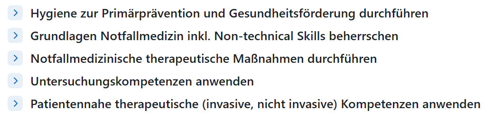
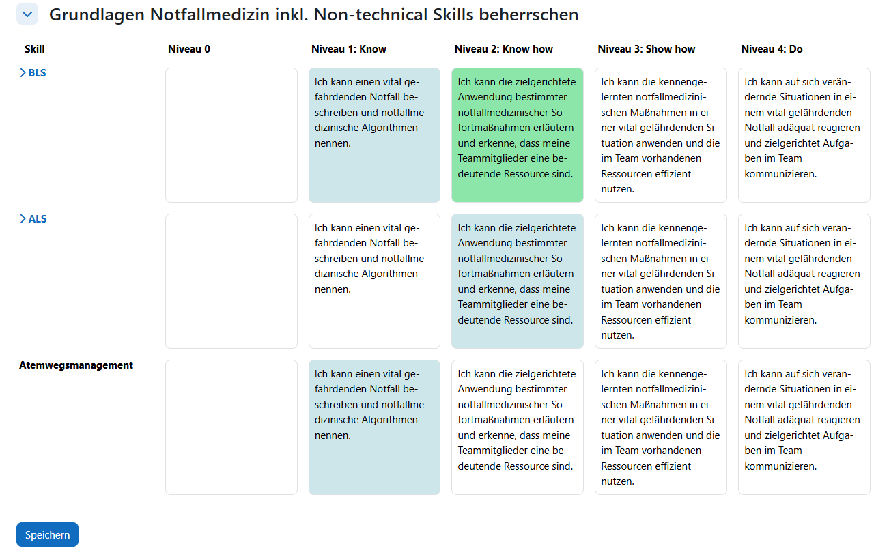
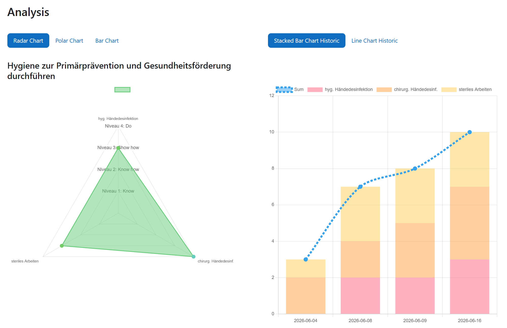
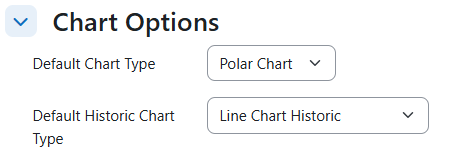
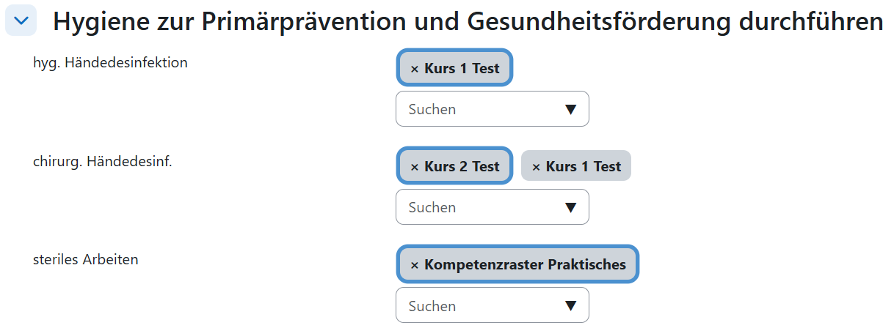
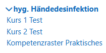
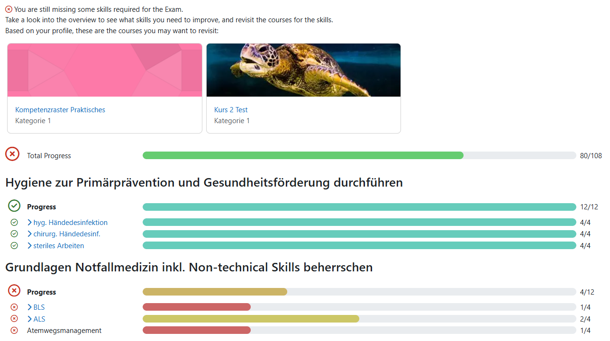
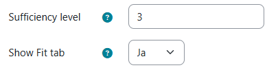
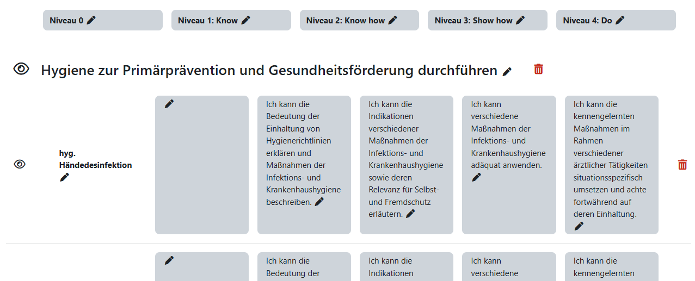

# Competency Grid #


 
**Warning!** This plugin is in Alpha Maturity and has not yet been tested in a production environment.


The Moodle Competency Grid plugin is an activity module which allows learners to track their progress in specific competencies.

Instructors can upload their competence grid as a csv file.
The csv file must have the structure as found in [Template.csv](docs/Template.csv). 

An exemplary file to show the needed structure is supplied in this repository, and may be provided to instructors. 

## Features

### Flexible upload
* **Upload as csv file** <br> Creating a new competencygrid activity is as easy as uploading a properly formatted ```.csv``` file. ```.csv``` files can be exported by most spreadsheet programs such as Excel, Google Sheets or Libre Office Calc. [Template.csv](docs/Template.csv) and [Template.xlsx](docs/Template.xlsx) files are provided within the repository.

> Important! CSV template files **HAVE** to use commas (,) as delimiters. Excel uses the Windows List separator which may be a semicolon (;) in some locales. Please use a different export solution then.


* **flexible number of skills + skill levels** <br> A competency grid can have any number of skills/subskills/skill levels. However, the number of skill levels per competency grid is fixed, and cannot vary between skills. In that case you can split the competency grid in seperate activities that have differing amounts of skill levels

### Intuitive filling out of competence grid

Each skill is displayed as a collapsed section, so that users gain an immediate overview over what is relevant for them.  



When unfolded, each skill can have multiple subskills with multiple levels, where each level - subskill combination can have its own unique description. Descriptions are displayed on clickable cards.



Previous User input is displayed with a lightblue background, while currently selected input has a green background.
Users only need to update the subskills that have changed, otherwise it is assumed that the level stayed consistent.

> Important : each subskill has its own submit button. Changes from other subskills are lost when clicking on submit of a different subskill.

### Historic tracking

User Input is tracked historically. The evolution of each skills input can be visualized on the Analysis page.

### Analysis page 
The analysis page shows a range of different chart types with the current fill-out status, as well different historic charts to visualize the learning progression



Charts showing the current learning state, will automatically use the provided level titles as axis annotations, while the historic charts will use the maximum possible amount of points achievable in a skill to set as the y-axis.

> Course Managers can edit which chart is used per default when users visit the Analysis page.
> 
> 

### Course references

> Instructors can associate other moodle courses with a subskill. The associated courses appear as clickable links when filling out the grid.
> 
> 
Intuitive and performant adding of courses to a skill, that uses the inbuild moodle course-picker component. 



Associated courses appear during filling out as clickable links.

### Fit page

The Plugin supports an additional "Are you fit?" page, which clearly shows which subskills meet the predefined sufficiency level. 



The top parts displays all courses which are associated with skills that are not sufficient yet.

> The sufficiency level and wheter the fit page is visible at all can be edited by the course manager in the Edit part of the activity
> 
> 


## Editing

When the editing option is active on the main page of the activity, course managers can edit the descriptions of the skills, subskills, levels and leveldescription. Additionally they can Add a new skill/subskill to the competency grid, set them as invisible or even delete them (**deletion is permanent, and will delete associated userinputs!**). When a skill is invisible, users can no longer create new userinputs, but it will still appear on the Analysis & Fit pages.



## Scheduled Tasks

The plugin will cleanup its own user data once a month on the first of the month, deleting all userinput data from users which are marked as deleted=1 in the user database table. 
Additionally another scheduled task is configured to delete very old user data. The default for this is 144 months (12 years), however the Moodle site Admin can configure this in the plugin settings.

If you do not want to delete data from users which are deleted, or you are unsure about the schedule of these tasks, consult your Moodle Site Admin, as they can adjust the schedule, timing and/or deactivate this task completely.


## Dependencies

[//]: # (TODO : Maybe include example csv structure and show during creation of activity)

This plugin is **not** related to the [Competence](https://docs.moodle.org/503/en/Competencies) functionality, but rather stands for itself. It does **not have any external dependencies** and can be used out of the box.

It does use some dependencies internally, but these are included here. See the [Third Party Notice](thirdpartylibs.xml) for more info.

## Installing via uploaded ZIP file ##

1. Log in to your Moodle site as an admin and go to _Site administration >
   Plugins > Install plugins_.
2. Upload the ZIP file with the plugin code. You should only be prompted to add
   extra details if your plugin type is not automatically detected.
3. Check the plugin validation report and finish the installation.

## Installing manually ##

The plugin can be also installed by putting the contents of this directory to

    {your/moodle/dirroot}/mod/competencygrid

for example by using git :

    cd {your/moodle/dirroot}/mod
    git clone https://github.com/MITZukdd/competencygrid

or by simply downloading this repository as a zip and unpacking it to the appropriate directory.

Afterwards, log in to your Moodle site as an admin and go to _Site administration >
Notifications_ to complete the installation.

Alternatively, you can run

    $ php admin/cli/upgrade.php

to complete the installation from the command line.

## Issues and Contributing

For Issues and Feature Requests you can open an [Issue](https://github.com/MITZukdd/CompetencyGrid/issues) on GitHub.

## License ##

2026 MITZ <mitz.software@ukdd.de>

This program is free software: you can redistribute it and/or modify it under
the terms of the GNU General Public License as published by the Free Software
Foundation, either version 3 of the License, or (at your option) any later
version.

This program is distributed in the hope that it will be useful, but WITHOUT ANY
WARRANTY; without even the implied warranty of MERCHANTABILITY or FITNESS FOR A
PARTICULAR PURPOSE.  See the GNU General Public License for more details.

You should have received a copy of the GNU General Public License along with
this program.  If not, see <https://www.gnu.org/licenses/>.
